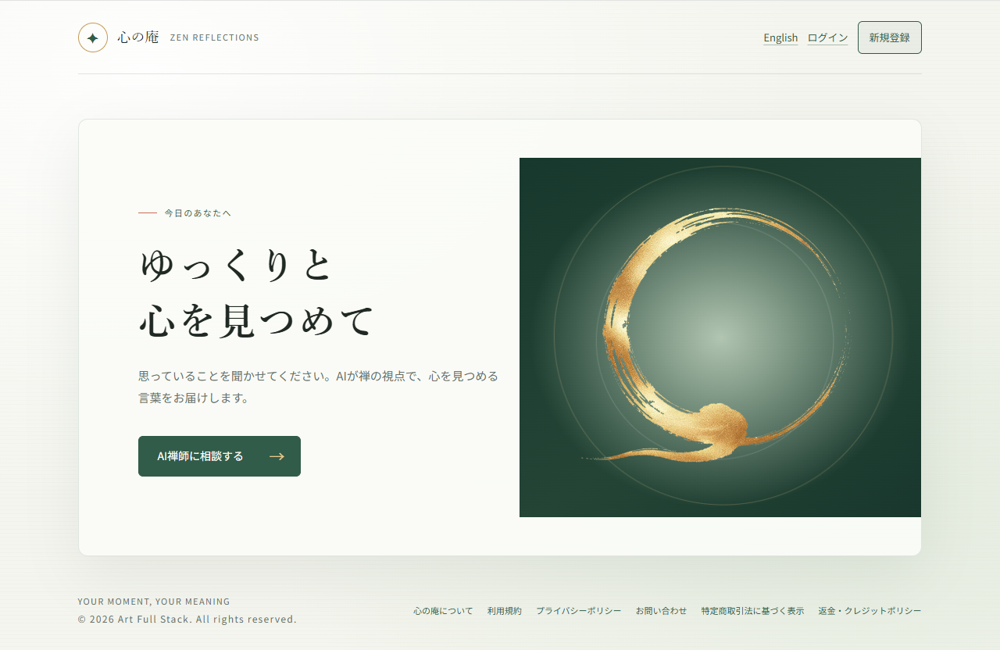
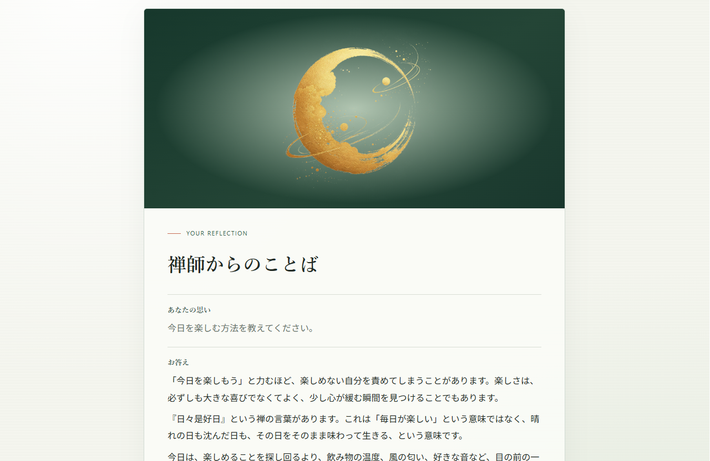

# ZEN — AI禅相談アプリ

AIを活用し、日常の悩みや迷いについて、禅の考え方を参考にしながら自分自身を見つめ直すためのWebアプリケーションです。

## 概要

**ZEN — 心の庵 ZEN REFLECTIONS** は、ユーザーが抱える悩みを言葉にし、落ち着いて自分の気持ちや状況を見つめ直すきっかけを提供する個人開発プロジェクトです。

AIによる対話を通じて、単に行動を指示したり、正解を押しつけたりするのではなく、ユーザーの気持ちに寄り添い、内省につながる言葉を届けることを目指しています。

企画・設計・実装から、本番環境へのデプロイまで、一貫して開発しています。

## 公開デモ

**Webアプリ：** [https://zen.art-full-stack.com/ja](https://zen.art-full-stack.com/ja)

## スクリーンショット

### トップページ



### AI相談画面



## 主な機能

- **AIによる悩み相談：** OpenAI APIを活用し、禅の視点から悩みや迷いを見つめ直すための対話機能
- **ユーザー認証：** ユーザー登録・ログイン機能
- **相談データ管理：** 相談に関するデータの保存・管理
- **多言語対応：** 日本語・英語に対応したインターフェース
- **本番環境への公開：** VPS環境へのデプロイと公開運用

## 使用技術

| 分類 | 技術 |
| --- | --- |
| バックエンド | PHP、Laravel 13 |
| フロントエンド | Blade、Tailwind CSS 4、Vite |
| データベース | MySQL |
| AI連携 | OpenAI API |
| 認証 | Laravel Socialite |
| 決済連携 | Stripe PHP SDK |
| インフラ | ConoHa VPS、Ubuntu、Nginx |
| バージョン管理 | Git、GitHub |
| 自動テスト | Pest |

## 技術的な取り組み

- Laravelを用いたWebアプリケーションの設計・実装
- OpenAI APIとの連携と、AIの応答方針を制御するプロンプト設計
- ユーザーの悩みに対して、行動指示に偏らず内省を促す対話設計
- 日本語・英語に対応した画面設計
- 環境変数を利用した設定情報・秘密情報の管理
- データベースマイグレーションによるスキーマ管理
- VPSへのデプロイ、Webサーバー設定、本番環境の運用
- Gitを用いたソースコード管理

## ローカル開発環境

### 必要な環境

- PHP 8.3+（PHP 8.x）
- Composer
- Node.js / npm
- MySQL または SQLite
- OpenAI API key

### セットアップ手順

1. リポジトリをクローンします。

   ```bash
   git clone https://github.com/TakahiroNago/zen-app.git
   cd zen-app
   ```

2. PHPの依存関係をインストールします。

   ```bash
   composer install
   ```

3. 環境設定ファイルを作成します。

   ```bash
   cp .env.example .env
   php artisan key:generate
   ```

4. `.env` にデータベース接続情報や、必要なAPIキーなどを設定します。

5. データベースのマイグレーションを実行します。

   ```bash
   php artisan migrate
   ```

6. フロントエンドの依存関係をインストールし、アセットをビルドします。

   ```bash
   npm install
   npm run build
   ```

7. 開発サーバーを起動します。

   ```bash
   php artisan serve
   ```

   詳細な設定は、`.env.example` および各種設定ファイルを参照してください。

## セキュリティ

- APIキー、データベース認証情報などの秘密情報は環境変数で管理します。
- `.env` などの機密情報を公開リポジトリにコミットしないようにします。
- 本アプリケーションはAIによる内省支援を目的としており、医療・法律・金融などの専門的判断を代替するものではありません。

## 開発者

**Takahiro Nago**

個人開発プロジェクト

- GitHub：[TakahiroNago](https://github.com/TakahiroNago)
